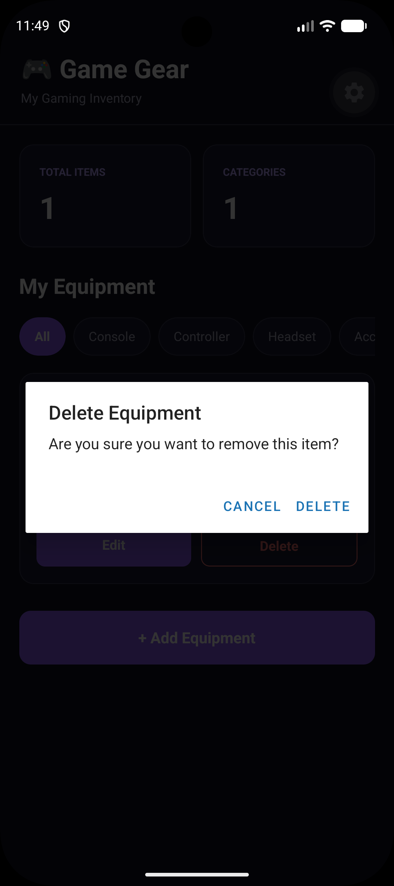
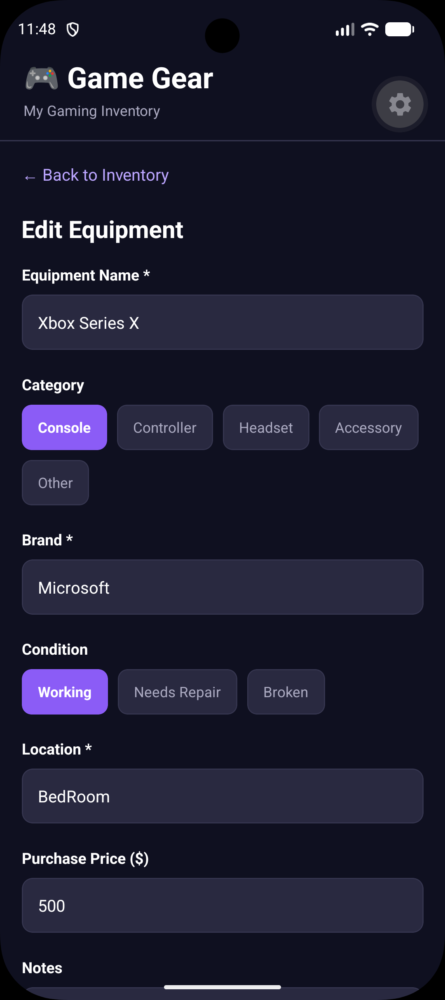
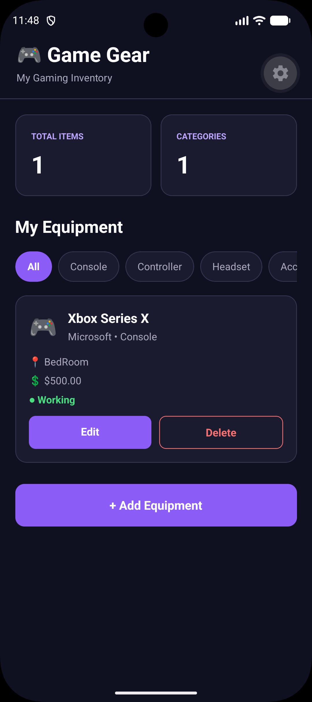

# Game Gear Inventory

**CMPS 460 – Mobile Development | Module 7 Homework**

## Project Overview

Game Gear Inventory is a React Native mobile application for keeping track of gaming equipment around the house. It is designed for items such as Xbox consoles, controllers, headsets, keyboards, and other accessories. The goal is to make it easy to see what equipment I own, where it is located, and what condition it is in.

The app uses a dark purple-and-black theme and runs through Expo on an Android emulator.

## Features

- **Add equipment:** Enter a name, category, brand, condition, location, purchase price, and optional notes.
- **View inventory:** See saved items in a list, along with their details.
- **Edit equipment:** Update an existing item's information.
- **Delete equipment:** Remove an item after a confirmation prompt.
- **Filter by category:** View all items or filter by Console, Controller, Headset, Accessory, or Other.
- **Input validation:** Require a name, brand, and location; reject invalid or negative prices.
- **Local storage:** Save inventory data on the device with AsyncStorage.
- **Inventory overview:** Display the total number of items and the number of categories represented.

## Technologies Used

- React Native
- Expo
- TypeScript
- `@react-native-async-storage/async-storage`
- Android emulator for testing

## Installation and Running the App

1. Install Node.js, Android Studio (with an Android emulator), and a compatible version of Expo Go on the emulator.
2. Open a terminal in the `GameGearInventory` project folder.
3. Install the project dependencies:

   ```bash
   npm install
   ```

4. Start Expo:

   ```bash
   npx expo start
   ```

5. Start the Android emulator and press `a` in the Expo terminal to open the app. If Expo Go reports a version mismatch, update Expo Go to a version compatible with the project's Expo SDK.

## How to Use

1. Open the app to view the inventory home screen.
2. Tap **+ Add Equipment** and fill out the form to create an item.
3. Use the category buttons to filter the inventory.
4. Tap **Edit** on an item to change its information and save the changes.
5. Tap **Delete** and confirm to remove an item.
6. Close and reopen the app to check that saved inventory data remains available.

## How AsyncStorage Works

The application stores its inventory as a JSON string under the key `@game_gear_inventory`. When the app opens, it reads the saved data with `AsyncStorage.getItem()` and loads it into React state. When the inventory changes, the app writes the updated list using `AsyncStorage.setItem()`. This allows data to remain on the device between app sessions without requiring a server or online database.

## Project Structure

```text
GameGearInventory/
├── App.tsx             # Inventory UI, forms, CRUD logic, and storage
├── index.ts            # App entry point
├── app.json            # Expo configuration
├── package.json        # Project dependencies and scripts
├── assets/             # App assets
├── screenshots/        # Screenshots for the homework submission
└── README.md           # Project documentation
```

## Screenshots




1. Inventory home screen with saved equipment
2. Delete Equipment 
3. Edit Equipment form

## Known Limitations

- Data is stored locally on one device; it does not sync between devices.
- There are no user accounts or cloud backups.
- The app does not support equipment photos or barcode scanning.
- The purchase price is recorded but does not automatically update to reflect an item's current value.
- Clearing the app's storage or uninstalling it may erase saved inventory data.

