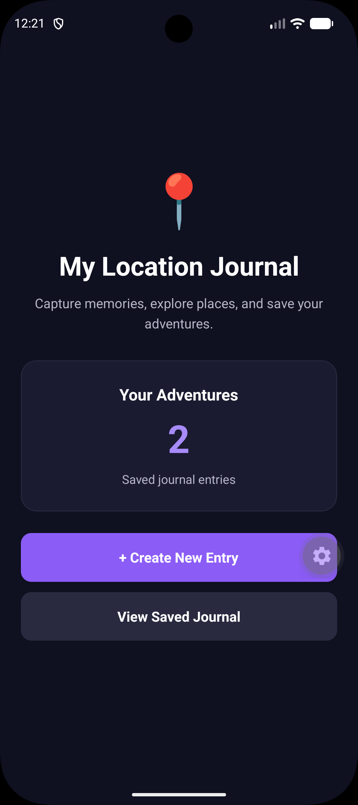
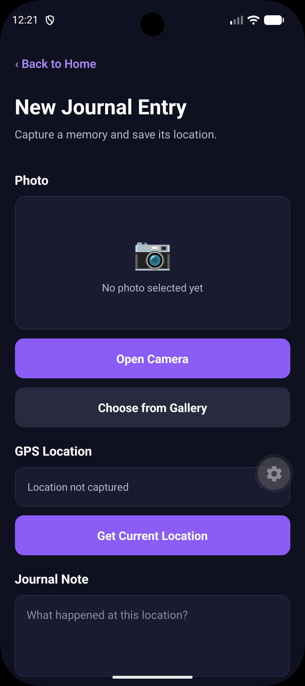
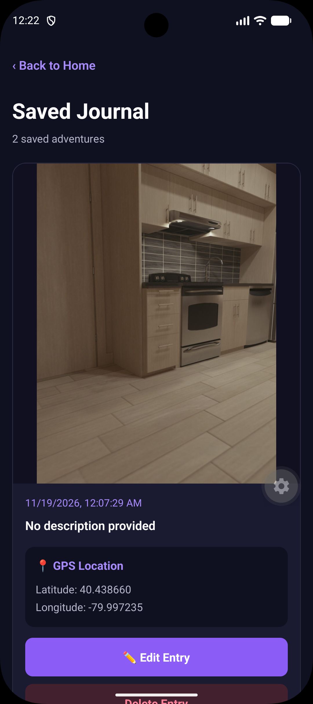

# Location Journal App

## Project Overview

The purpose of this application is to allow users to capture photos, record their GPS coordinates, and save memories from different locations. Users can create journal entries, add descriptions, view previously saved entries, edit notes, and delete entries.

The application uses local storage so that journal entries remain available even after closing and reopening the app.

## Features

- **Camera:** Take photos directly through the device's camera.
- **Photo Gallery:** Select existing photos from the device.
- **GPS Location:** Retrieve the user's current latitude and longitude.
- **Journal Notes:** Add descriptions to photos and locations.
- **Saved Journal:** View previously created entries with their photos, notes, GPS coordinates, and timestamps.
- **Edit Entries:** Update journal notes without deleting the original entry.
- **Delete Entries:** Remove saved entries and their stored photos.
- **Local Storage:** Save journal information using AsyncStorage and store photos locally.
- **Error Handling:** Display messages when permissions are denied or an operation fails.

## Technologies Used

- React Native
- Expo
- TypeScript
- Expo Image Picker
- Expo Location
- Expo File System
- AsyncStorage
- React Native Safe Area Context


## Installation and Setup

1. Install Node.js and Expo's required development tools.
2. Download or clone the project repository.
3. Open the project folder in Visual Studio Code.
4. Open a terminal in the project directory.
5. Install the project dependencies:

```bash
npm install
```

6. Start the Expo development server:

```bash
npx expo start
```

7. Press `a` to open the application in an Android emulator, or use another supported device.

## How to Use the Application

1. Open the Location Journal application.
2. Select the option to create a new journal entry.
3. Take a photo using the camera or choose one from the gallery.
4. Press the location button to retrieve GPS coordinates.
5. Enter an optional description of the location or experience.
6. Save the journal entry.
7. Open Saved Journal to view previously created entries.
8. Use Edit Entry to change an existing description or Delete Entry to remove an entry.

## Application Screenshots

### Screenshot 1: Home Screen

The home screen allows users to navigate between creating a journal entry and viewing saved entries. It also displays the number of saved journal entries.




### Screenshot 2: Create Journal Entry

The Create Journal Entry screen allows users to take or select a photo, retrieve GPS coordinates, enter a note, and save their entry.




### Screenshot 3: Saved Journal

The Saved Journal screen displays saved photos, descriptions, GPS coordinates, and timestamps. Users can also edit notes or delete entries.




## Data Storage

The application uses AsyncStorage to save journal entry information locally on the device. Photos are copied into the application's local file storage using Expo File System.

Each journal entry contains:

- Unique entry ID
- Photo URI
- Latitude
- Longitude
- Journal note
- Date and time

This allows saved entries to remain available after the application is closed and restarted.

## Testing

The application was tested using an Android emulator.

The following functionality was successfully tested:

- Taking photos using the camera
- Selecting photos from the gallery
- Retrieving GPS coordinates
- Creating and saving journal entries
- Displaying saved photos correctly
- Editing existing journal notes
- Deleting journal entries
- Confirming saved entries remain after restarting the application

## Conclusion

This project helped me gain more experience developing mobile applications using React Native and Expo. I learned how to work with device features such as the camera and GPS, manage permissions, and store information locally.

One of the biggest challenges was getting captured photos to display correctly after saving them. After making changes to the camera functionality and photo storage process, I was able to resolve the issue.

Overall, the Location Journal application demonstrates how different mobile device features can work together to create a useful application for recording memories and experiences.