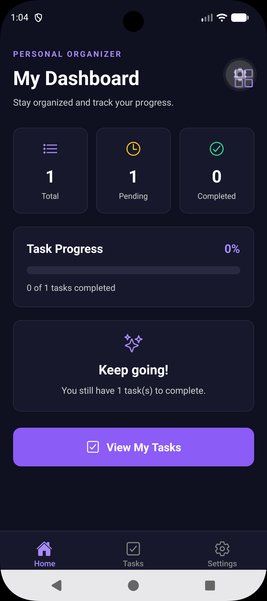
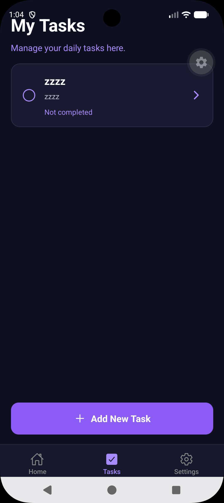
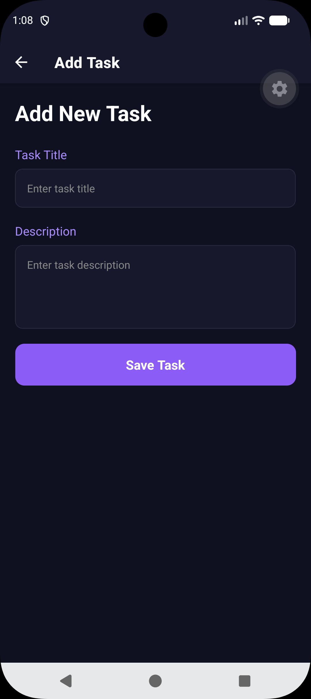
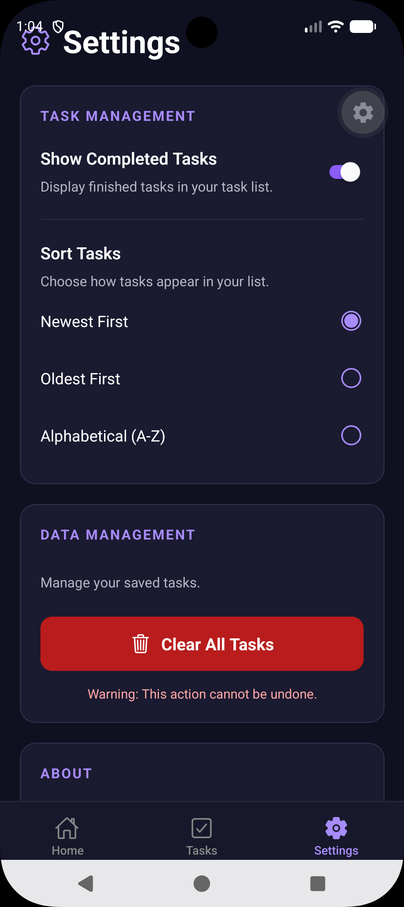

# Personal Task Organizer

## Project Overview

The Personal Task Organizer is a mobile application I developed using React Native, Expo, and TypeScript. The purpose of this application is to help users organize their daily tasks, keep track of what they need to complete, and monitor their overall progress.

I wanted to create an application that was simple to navigate while still offering useful features. The application uses a midnight-purple and black color scheme to give it a modern appearance.

## Features

### 1. Home Dashboard
The Home Dashboard gives users an overview of their tasks. It displays the total number of tasks, how many are pending, and how many have been completed. It also includes a progress bar that updates based on the percentage of completed tasks.

### 2. My Tasks
The My Tasks screen displays the user's saved tasks, including their titles, descriptions, and completion status. Users can also access the Add Task screen from this page.

### 3. Add Task
The Add Task screen allows users to create tasks by entering a title and description. Once a task is saved, it can appear in the task list.

### 4. Settings
The Settings screen allows users to customize how their tasks are displayed. It includes options for showing completed tasks, sorting tasks by newest, oldest, or alphabetical order, and managing saved tasks.

## Technologies Used

- **React Native:** Used to build the mobile application's interface.
- **Expo:** Used to run and test the application on an Android emulator.
- **TypeScript:** Used to organize the code and provide type checking.
- **React Navigation:** Used to navigate between screens.
- **React Context:** Used to share task information between components.
- **React Hooks:** Used to manage application state and update the interface.
- **Ionicons:** Used for navigation icons and other visual elements.
- **AsyncStorage:** Used for saving task information locally on the device.

## Screenshots

### Home Dashboard
The dashboard displays task statistics, progress tracking, and a button to view saved tasks.

### My Tasks
This screen displays saved tasks and provides access to the Add New Task feature.

### Add Task
This screen allows users to enter a task title and description before saving.

### Settings
This screen contains options for sorting tasks, displaying completed tasks, and managing saved information.

## How to Run the Application

1. Install Node.js and the required project dependencies.
2. Open the project folder in Visual Studio Code.
3. Open the terminal and run `npm install`.
4. Start the Expo development server using `npx expo start`.
5. Press `a` in the terminal to launch the Android emulator.
6. Once the application loads, use the bottom navigation bar to explore the different screens.

## Project Structure

The application is organized into separate screens for the Home Dashboard, My Tasks, Add Task, and Settings pages. React Navigation handles movement between screens, while React Context allows task information to be shared throughout the application.

## Project Summary

Developing the Personal Task Organizer allowed me to comprehend the ways various components of a mobile application function. Specifically, I gained experience in applying React Native components, React hooks for handling data and implementing navigation through several screens in a mobile application. One of the components I liked creating the most is the dashboard since it provides an opportunity to show the task data stored in the database in an understandable form. In addition, I gained further insights into applying AsyncStorage in order to store the data persistently. In conclusion, developing this mobile application allowed me to develop further experience in creating the functional mobile application while learning TypeScript and other aspects.