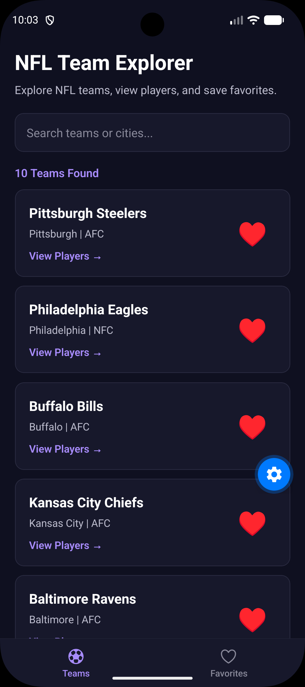
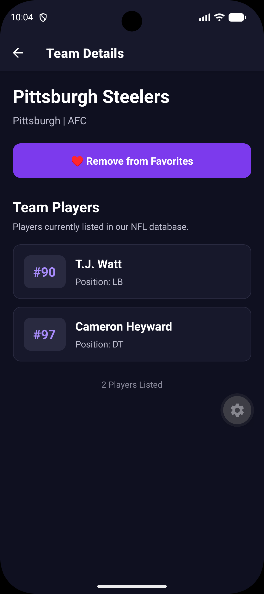

# NFL Team Explorer

## Project Description

NFL Team Explorer is a mobile application created using
React Native, Expo, and TypeScript.

The application allows users to explore NFL teams,
search for specific teams, view player information,
and save their favorite teams.

This project was developed for Module 9 of
CMPS 460 Mobile Development.

## Features

- Displays 10 NFL teams using FlatList.
- Shows each team's name, city, and conference.
- Allows users to search by team name or city.
- Displays at least two players for each team.
- Shows player names, positions, and jersey numbers.
- Allows users to add and remove favorite teams.
- Saves favorites locally using AsyncStorage.
- Includes Teams and Favorites navigation tabs.
- Displays a message when no teams match a search.
- Uses a dark purple theme throughout the app.

## Technologies Used

- React Native
- Expo
- TypeScript
- React Navigation
- AsyncStorage
- FlatList
- React Hooks (useState and useMemo)
- Local JSON Data

## Data Source

The application uses a local JSON file named
teams.json located in the data folder.

This file contains information for 10 NFL teams,
including their names, cities, conferences,
and sample players.

Each team contains at least two players with
their names, positions, and jersey numbers.

Using local JSON allows the application to
display team information without requiring
an internet connection or external API.

## Installation and Running the App

### Step 1: Open the Project

Open the NFLTeamExplorer folder in Visual Studio Code.

### Step 2: Install Dependencies

Run the following command in the terminal:

    npm install

### Step 3: Start Expo

Run:

    npx expo start

### Step 4: Open the Emulator

Press A in the Expo terminal to launch
the application in the Android emulator.

If the application needs to be refreshed, run:

    npx expo start -c

## How to Use the Application

1. Open the app to view the list of NFL teams.
2. Use the search bar to find a team by name or city.
3. Tap "View Players" to see the team's player information.
4. Tap the heart icon to add a team to favorites.
5. Open the Favorites tab to view saved teams.
6. Tap the heart again to remove a team from favorites.
7. Close and reopen the app to confirm favorites remain saved.

## Screenshots

### Screenshot 1: Teams Screen

This screen displays the NFL teams, search bar,
and favorite buttons.

### Screenshot 2: Team Details Screen

This screen displays information about a selected
NFL team, including player names, positions,
and jersey numbers.

### Screenshot 3: Favorites Screen

This screen displays the teams that the user
has added to their favorites.

## Challenges and Learning Experience

One of the challenges in this project was

incorporating the navigation between the Teams screen

and the Team Details screen. The challenge was to ensure

that favorite teams were stored even when the app was closed.

React Navigation allowed me to organize the various screens,

while AsyncStorage allowed me to ensure that favorite teams

were stored locally. This project helped me develop my

abilities in FlatList, React Hooks, navigation,

local data management, and mobile app development.

## Conclusion

The NFL Team Explorer application demonstrates
how React Native can be used to create an
interactive mobile application.

The project combines navigation, searching,
local JSON data, and persistent storage to
provide users with a simple way to explore
NFL teams and manage their favorites.
